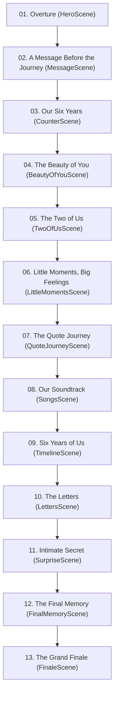

# Content & Narrative Architecture

### Project: K & N — Six Years, One Story
**Dedicated to:** Nasreen  
**Author:** Kausik  
**Milestone:** 23 November 2020 → 23 November 2026 (Six-Year Anniversary)

---

## The 13-Scene Narrative Arc

---

## Detailed Scene Breakdown

### Scene 01: Overture (`#hero`)
- **Component:** `components/sections/HeroScene.tsx`
- **Purpose:** Atmospheric grand opening establishing the **K & N** identity, relationship milestone, and ambient mood.
- **Key Elements:**
  - Floating K & N luxury typographic wordmark with animated gold hairline keyline.
  - Tagline: *"Six Years. One Story. A Thousand Feelings."*
  - Dedicated invitation CTAs: *"Begin Our Story"* (smooth scroll to Scene 02) and *"The Six-Year Milestone"* (smooth scroll to Scene 03).
  - Background: Particle silk simulation with deep burgundy lighting vignette.

### Scene 02: A Message Before the Journey (`#message-before-journey`)
- **Component:** `components/sections/MessageScene.tsx`
- **Purpose:** Quiet, intimate prologue setting an emotional tone before photography begins.
- **Key Copy:**
  - *"Some people have a way of making the world feel a little softer. You are that person for me."*
  - Dedication: *Kausik & Nasreen — 23 November 2020 — 23 November 2026*.

### Scene 03: Our Six Years (`#counter`)
- **Component:** `components/sections/CounterScene.tsx`
- **Purpose:** Celebrates the exact temporal scale of the six-year relationship with high-precision calendar math.
- **Key Elements:**
  - Milestone headline: *2,191 Days of Devotion*.
  - Tabular numerals displaying Years, Months, Days, Hours, Minutes, and Seconds.
  - Triple-mode operational engine:
    1. *Before Anniversary Mode:* Live countdown to 23 November 2026.
    2. *Anniversary Day Mode:* Grand celebration with rose-gold badge and celebratory text.
    3. *After Anniversary Mode:* Live counter measuring the journey beyond six years into forever.
  - Interactive quote carousel cycling through Kausik's reflections.

### Scene 04: The Beauty of You (`#beauty-of-you`)
- **Component:** `components/sections/BeautyOfYouScene.tsx`
- **Purpose:** Editorial portrait gallery celebrating Nasreen's effortless grace, kindness, and quiet radiance.
- **Key Photography:**
  - `IMG_0724.JPG` (Signature DSLR natural portrait).
  - `IMG-20240411-WA0038.jpg`, `IMG_20240801_040421.jpg`, `IMG_20230814_085427.jpg`, `IMG_20240205_112434.jpg`.
- **Composition:** Asymmetric arch frames, gold hairline borders, hover magnification, and paired admiration lines placed beside/below image frames.

### Scene 05: The Two of Us (`#the-two-of-us`)
- **Component:** `components/sections/TwoOfUsScene.tsx`
- **Purpose:** Landmark moments of Kausik and Nasreen together across the six years.
- **Key Photography:**
  - `IMG-20210516-WA0011.jpg` (2021 foundation landmark).
  - `IMG_20231018_221857.jpg`, `IMG_20220503_095120.jpg`.
  - 21:9 Ultrawide Golden-Hour Sunset Masterpiece (`IMG_20250607_104001.jpg`).
- **Feature:** Fullscreen interactive lightbox modal with zoom and high-definition detail.

### Scene 06: Little Moments, Big Feelings (`#little-moments`)
- **Component:** `components/sections/LittleMomentsScene.tsx`
- **Purpose:** Celebrates the unscripted everyday candids—tea growing cold, sudden giggles, quiet walks.
- **Composition:** Tilted Polaroid cards, nostalgic filmstrip sprockets, textured paper grain, and handwritten-style captions.

### Scene 07: The Quote Journey (`#quotes-journey`)
- **Component:** `components/sections/QuoteJourneyScene.tsx`
- **Purpose:** Full literary sanctuary containing 67 original quotes authored in Kausik's voice across 10 categories.
- **Categories:**
  1. *Love & affection*
  2. *Beautiful smiles*
  3. *Togetherness*
  4. *Six years*
  5. *Memories*
  6. *Gratitude*
  7. *Missing you*
  8. *Forever*
  9. *Little things*
  10. *Personal letters*
- **Interactive Feature:** *"Draw a Random Love Note"* modal with rose-gold sparkles and bookmark capability.

### Scene 08: Our Soundtrack (`#soundtrack`)
- **Component:** `components/sections/SongsScene.tsx`
- **Purpose:** Interactive vinyl showcase featuring the two meaningful songs of the relationship.
- **Featured Tracks:**
  1. *Alfaaz* (3:45 · Sacred Devotion)
  2. *Dilruba Dilnasee* (4:12 · Classical Romance)
- **Features:** Floating audio dock, live frequency visualizer bars, vinyl spinning physics, and full playlist navigation.

### Scene 09: Six Years of Us (`#timeline`)
- **Component:** `components/sections/TimelineScene.tsx`
- **Purpose:** Chronological retrospective traversing 2020 through 2026.
- **Milestones:**
  - **2020:** The Genesis (23 November 2020)
  - **2021:** Finding Our Rhythm
  - **2022:** Unspoken Understanding
  - **2023:** Deepening Devotion
  - **2024:** Weathering & Growing
  - **2025:** Certainty
  - **2026:** Six Years & The Golden Era
- **Controls:** Interactive milestone pills, prev/next arrows, and keyboard arrow keys.

### Scene 10: The Letters (`#letters`)
- **Component:** `components/sections/LettersScene.tsx`
- **Purpose:** Three bespoke keepsake letters presented on physical-inspired deckled parchment.
- **The Envelopes:**
  - *Letter 01:* "To the Girl Who Became My Favourite Part of Every Day" (Wax seal).
  - *Letter 02:* "For All the Beautiful Chapters We Have Yet to Write" (Wax seal).
  - *Letter 03:* "Open When You Miss Me" (Rose-gold silk ribbon knot seal).
- **Features:** Interactive seal break animation, reading speed modes (Slow, Reflective, Full), drop cap typography, and window print formatting.

### Scene 11: Intimate Secret (`#surprise`)
- **Component:** `components/sections/SurpriseScene.tsx`
- **Purpose:** Tactile interactive surprise unlocked by pressing and holding the gold seal for 3 seconds.
- **Reward:** Rose-petal confetti explosion, haptic vibration, and handwritten promise keepsake.

### Scene 12: The Final Memory (`#final-memory`)
- **Component:** `components/sections/FinalMemoryScene.tsx`
- **Purpose:** Climactic full-bleed portrait focus on Nasreen (`DSC_0111_1.JPG`).
- **Signature Line:**
  - *"If I had to walk the last six years all over again, through every quiet dawn and every uncertain night, I would search for you in every lifetime—and choose you all over again."*

### Scene 13: The Grand Finale (`#finale`)
- **Component:** `components/sections/FinaleScene.tsx`
- **Purpose:** Timeless closing dedication.
- **Copy:**
  - *"Made with love, by Kausik."*
  - *"For Nasreen, with all my love."*
  - *"23 November 2020 — Forever."*
  - Smooth *"Replay Our Story"* control.
