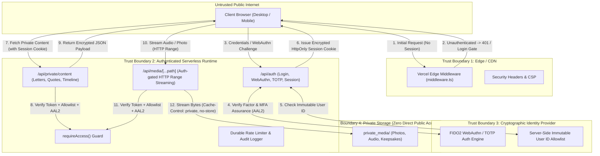

# K & N Anniversary Platform — Threat Model (v2)

**Document Version:** 2.0.0  
**Classification:** Confidential / Security Architecture  
**Target Application:** K & N Private Anniversary Application  
**Authors:** Principal Application Security Architect, Authentication & DevSecOps Engineering  

---

## 1. Executive Summary & Objective

The objective of the K & N platform is to celebrate a private relationship milestone (23 November 2020 → 23 November 2026). The platform contains deeply personal, intimate media: private letters, high-resolution family/couple photographs, customized relationship milestones, and proprietary curated assets.

**Core Security Invariant:**
> *Only individually invited, identity-verified, and explicitly authorized people who have completed strong multi-factor authentication (MFA) can read a single byte of private content. Everything else fails closed.*

---

## 2. Asset Classification

| Asset ID | Asset Description | Sensitivity | Impact of Exposure | Current Storage / Delivery |
| :--- | :--- | :--- | :--- | :--- |
| **AST-01** | High-Resolution Original Photos | **Confidential** | Severe privacy violation | `OurPictures/` (49 files) |
| **AST-02** | Optimized Couple & Portrait Photos | **Confidential** | Severe privacy violation | `public/images/our-story/` |
| **AST-03** | Three Keepsake Love Letters | **Strictly Secret** | Extreme emotional harm | `content/letters.ts` (client bundle) |
| **AST-04** | Intimate Secret Surprise Message | **Strictly Secret** | Extreme emotional harm | `content/surprise.ts` (client bundle) |
| **AST-05** | Master Audio Tracks (*Alfaaz*, *Dilruba*) | **Protected** | Copyright & privacy exposure | `public/audio/` (CDN direct) |
| **AST-06** | 67 Curated Quotes & 19 Pairings | **Confidential** | Privacy & personal sentiment | `content/quotes.ts` |
| **AST-07** | Relationship Timeline (2020–2026) | **Confidential** | Intimate milestone disclosure | `content/timeline.ts` |
| **AST-08** | User Accounts & Identities (K & N) | **Critical** | Account takeover | Identity Provider (IdP) |
| **AST-09** | Owner Administrative Capability | **Critical** | Full system compromise | Server Environment & Admin API |

---

## 3. Threat Actors & Adversary Profiles

1. **Adversary A — Automated Internet Crawler / Web Scraper**:
   - *Motivation*: Indexing, scraping public buckets, data aggregation.
   - *Capabilities*: Scans common paths (`robots.txt`, sitemaps, `/.git`, `/_next/static`, `/audio`, `/images`).
2. **Adversary B — Acquaintance / Targeted Date Guesser**:
   - *Motivation*: Curiosity, snooping on couple's private website.
   - *Capabilities*: Knows relationship anniversary date (`23112020`, `23-11-2020`, `23/11/2020`) and names.
3. **Adversary C — Leaked / Forwarded Link Recipient**:
   - *Motivation*: Unauthorized observation via casual link sharing or social forwarding.
   - *Capabilities*: Has the direct URL `https://k-and-n-gold.vercel.app` or deep resource URLs.
4. **Adversary D — Credential-Stuffing & Brute-Force Botnets**:
   - *Motivation*: Account takeover, automated credential probing.
   - *Capabilities*: High-velocity dictionary attacks, credential lists, distributed proxies.
5. **Adversary E — Authorized-but-Unapproved Account**:
   - *Motivation*: An outsider attempts to sign up via open registration, or signs in with an unlisted Gmail/OAuth account.
   - *Capabilities*: Has a valid third-party email or identity, but has not been authorized by Kausik.
6. **Adversary F — Physical Bystander (Device Loss / Borrowed Phone)**:
   - *Motivation*: Opportunistic snooping when a phone is left unlocked on a table.
   - *Capabilities*: Temporary direct physical touch on an authorized device.
7. **Adversary G — Phishing Attacker Targeting the Viewer**:
   - *Motivation*: Intercept credentials or session tokens.
   - *Capabilities*: Fake login pages, reverse-proxy man-in-the-middle phishing attacks.
8. **Adversary H — Repository / Build History Snooper**:
   - *Motivation*: Data extraction from secondary surfaces.
   - *Capabilities*: Inspects past Git commits, old Vercel deployment preview URLs, build logs, or CDN caches.

---

## 4. Out of Scope (Honest Boundaries)

- **Authorized Viewer Screen Capture**: If Nasreen or Kausik takes a physical photo of the screen with another phone or a system screenshot, software controls cannot prevent this. Light friction (no-download menus) is deterrent only, not a security boundary.
- **Compromised Client Endpoint**: Devices infected with OS-level kernel rootkits or keyloggers cannot be defended against by browser web security.
- **Nation-State / Subpoena Adversaries**: Advanced state actors with hardware implants or judicial warrants against hosting cloud providers.

---

## 5. Data Flow Diagram & Trust Boundaries

---

## 6. Abuse-Case Matrix

| # | Attack Scenario | Entry Point | Architectural Security Control | Verification Test |
| :--- | :--- | :--- | :--- | :--- |
| **AC-01** | Direct unauthenticated GET for private photos or audio | `/images/...`, `/audio/...` | Move assets to `private_media/`, route through `/api/media/...` requiring valid AAL2 session. Direct paths 404/401. | `DirectAccessTest.media_rejects_unauthenticated` |
| **AC-02** | Direct inspection of Next.js static JS chunks to read letters | `/_next/static/chunks/*.js` | Remove `LETTERS_DATA`, `QUOTES_DATA`, `SURPRISE_DATA` from bundle. Fetch dynamically post-auth via `/api/private/content`. | `ContentExposureTest.canary_scan_zero_hits` |
| **AC-03** | Guessing old anniversary date password | `/` or `/api/auth/verify` | Delete old date-based gate, remove date-checking endpoints, eliminate `ANNIVERSARY_ACCESS_CODE`. | `BypassTest.date_passcode_fails` |
| **AC-04** | Credential stuffing on login | `/api/auth/login` | Durable rate limiting per IP and per identifier, progressive delay, generic rejection copy. | `AttackResistanceTest.brute_force_throttled` |
| **AC-05** | Unauthorized user registers or logs in with arbitrary email | Auth provider flow | Self-registration disabled. Explicit server-side allowlist checked on every request. | `IdentityMatrixTest.unallowlisted_account_denied` |
| **AC-06** | User completes password step but bypasses MFA | Session establishment | Token must assert `aal: "aal2"` and verified factor. Middleware and API handlers verify AAL2. | `IdentityMatrixTest.mfa_incomplete_denied` |
| **AC-07** | Attacker uses forged or tampered JWT / `alg: none` | Any API endpoint | Cryptographic HMAC-SHA256 / EdDSA verification with strict algorithm, audience, and expiry enforcement. | `IdentityMatrixTest.tampered_jwt_rejected` |
| **AC-08** | Client sends fabricated header `x-kn-authenticated: 1` | Incoming HTTP headers | `requireAccess()` inspects server-side session cookie, completely ignoring client-supplied headers. | `IdentityMatrixTest.forged_client_flags_ignored` |
| **AC-09** | Stolen session cookie used after owner revokes access | Any authenticated route | Server checks revocation registry on every request. Revocation takes effect immediately. | `SessionTest.revocation_kills_session_instantly` |
| **AC-10** | Path traversal attempt to read server files | `/api/media/../../../.env` | Path resolution sanitized against base root, strict whitelist of relative media paths. | `AttackResistanceTest.path_traversal_rejected` |
| **AC-11** | Clickjacking / iframe embedding | Iframe on malicious site | `Content-Security-Policy: frame-ancestors 'none'`, `X-Frame-Options: DENY`. | `HeaderTest.frame_ancestors_enforced` |
| **AC-12** | Identity Provider or Allowlist Store Outage | Network failure | Fail closed. If IdP or verification cannot be completed, return 503/401, never allow open bypass. | `ResilienceTest.fail_closed_on_outage` |
